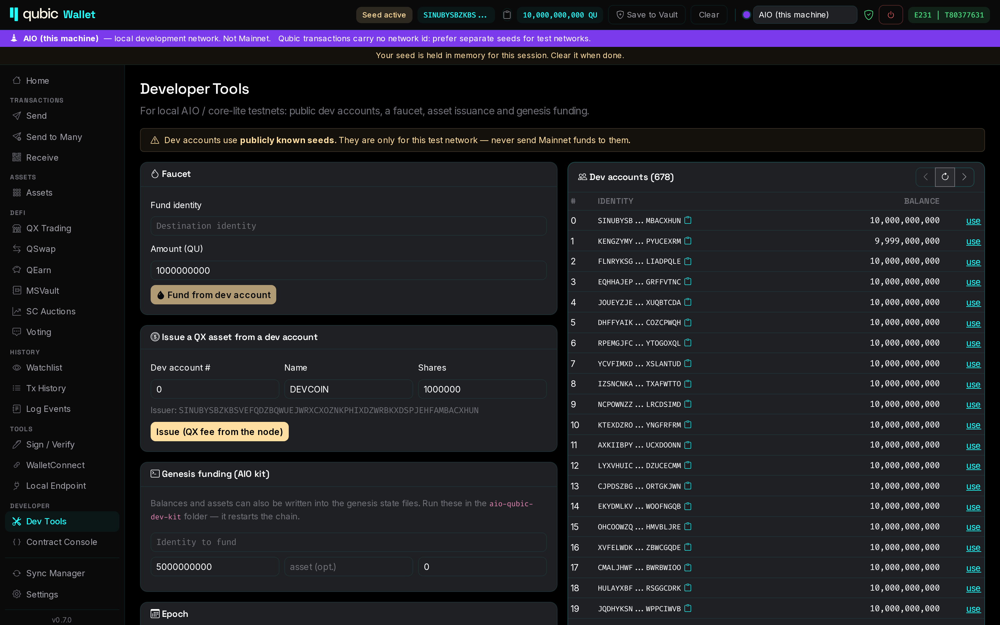
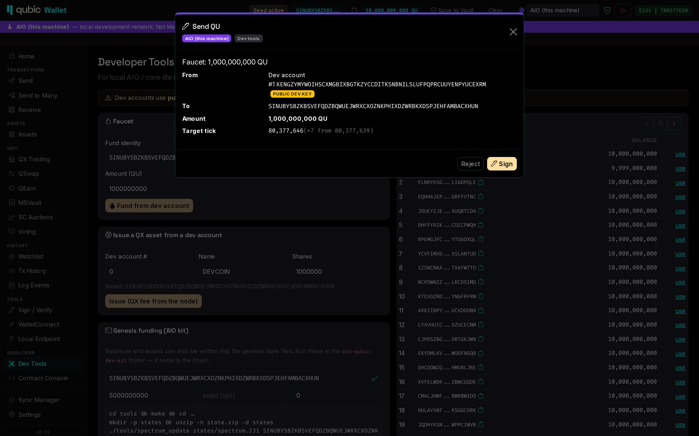
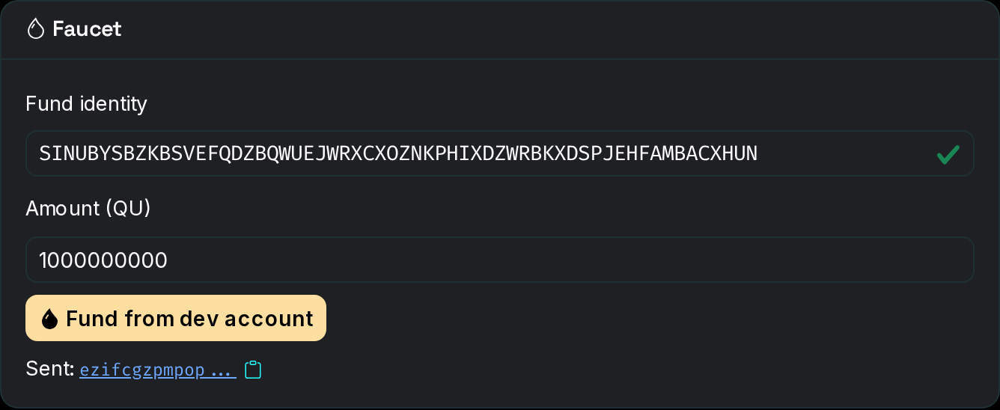
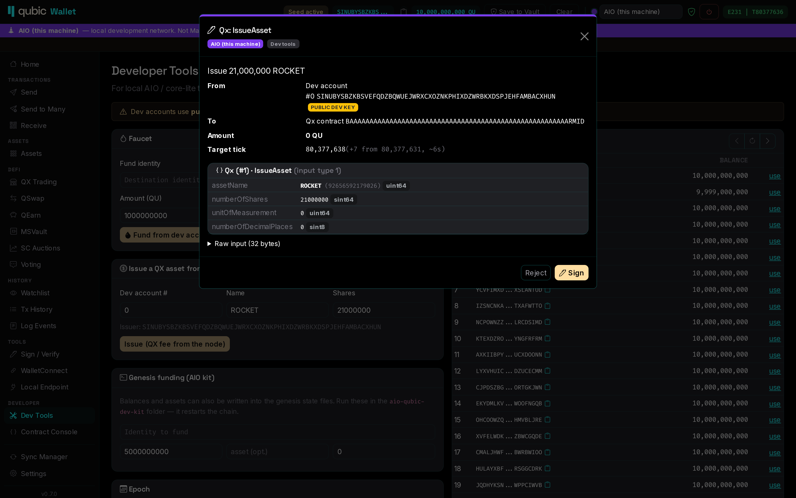
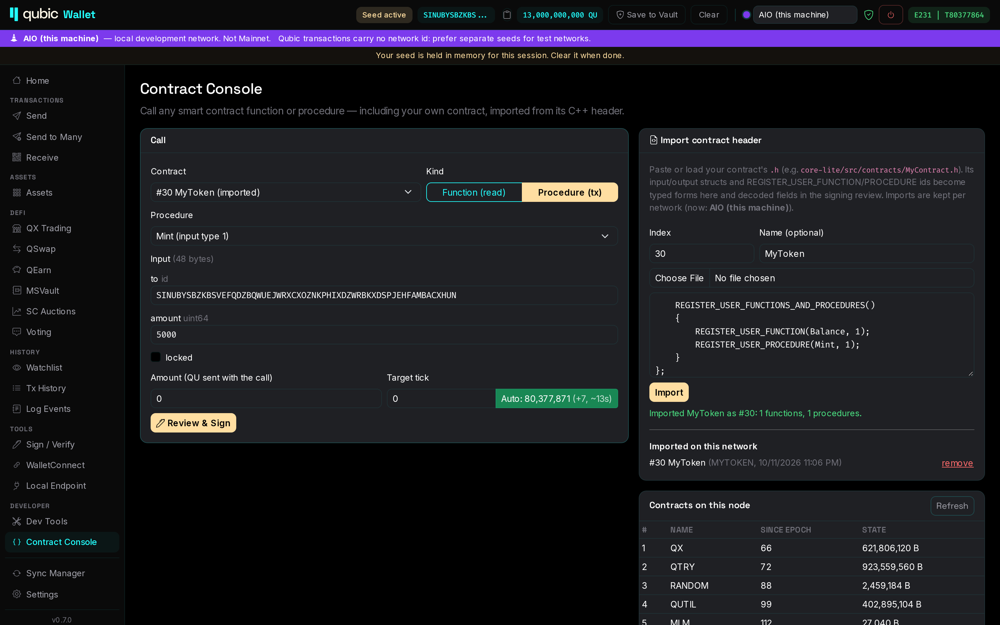
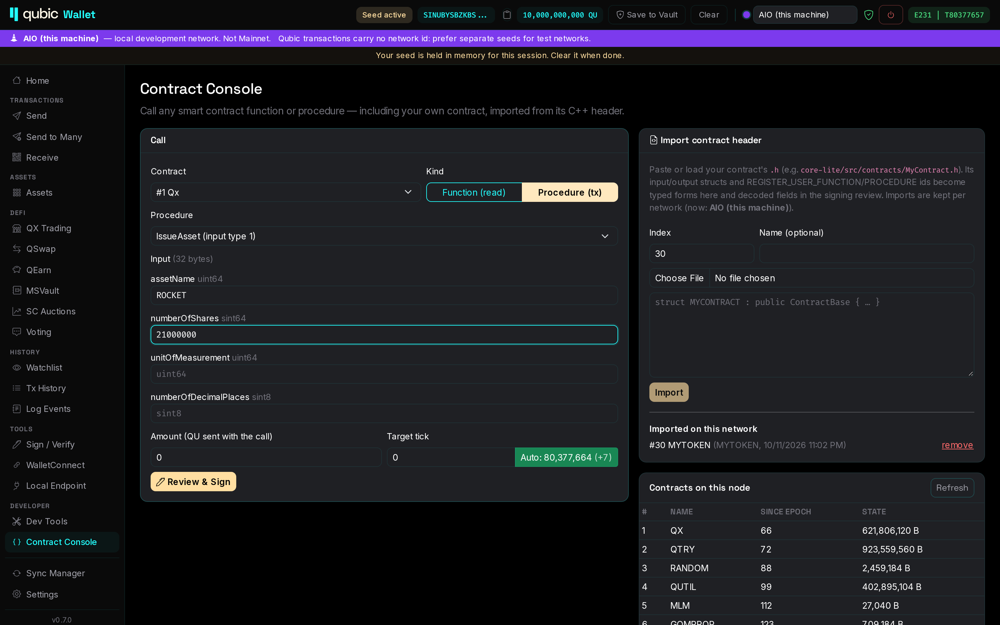
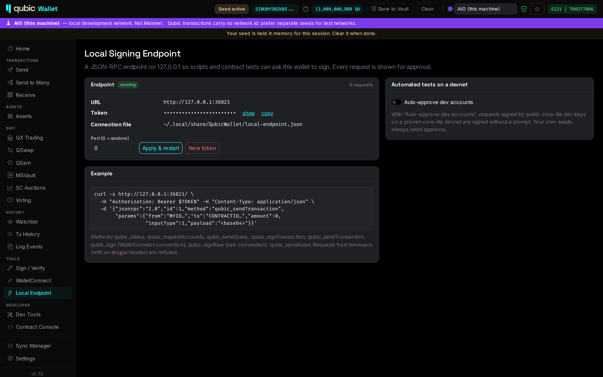

# Tutorial: a local Qubic testnet with the AIO Dev Kit and Qubic.Net Wallet

This tutorial takes you from nothing to a running local Qubic network with a working wallet: funded
accounts, transfers, your own asset, and a call to your own smart contract, with no `qubic-cli`.
It takes about 30 minutes, most of it waiting for the kit to build.

You need:

- A Linux x86-64 machine with **AVX2** and at least **24 GB RAM** for the kit (32 GB with the explorer).
  This can be a remote server; the wallet can run on your laptop.
- Qubic.Net Wallet **0.7.0 or later** (desktop: Windows, macOS, Linux; or Android).

> [!WARNING]
> The kit uses the same tick numbers as Mainnet, and Qubic transactions carry no network id.
> A transaction you sign on the kit can also be valid on Mainnet. **Use seeds that hold nothing on Mainnet.**
> The wallet warns you when a seed signs on both, but separate seeds are the real protection.

## 1. Start the kit

On the Linux machine (Ubuntu 24.04 shown):

```bash
sudo apt-get update && sudo apt-get install -y docker.io docker-compose-v2 git python3 make g++ unzip
git clone --recurse-submodules https://github.com/qubic/aio-qubic-dev-kit.git && cd aio-qubic-dev-kit
cp .env.example .env
sed -i 's/^COMPOSE_PROFILES=.*/COMPOSE_PROFILES=/' .env   # no explorer: saves ~8 GB RAM
./scripts/up.sh
```

Wait until Bob follows the chain:

```bash
docker compose logs -f core-bob | grep 'Current state'
```

The kit is healthy when `FetchingTick` goes up by about one tick per second.

If the core-lite build stops with a `static_assert` in `revenue.h`, set `EPOCH_TICK_CAPACITY=5184001`
in `.env` and run `docker compose build core-lite && ./scripts/up.sh`. The tick capacity plus 3 must be
divisible by 4, and some kit versions ship a default that is not.

The wallet needs two of the kit's ports:

| Port | Service | Wallet uses it for |
|---|---|---|
| `40420` | Bob JSON-RPC and WebSocket | ticks, balances, broadcast, contract queries, receipts, logs |
| `41841` | core-lite HTTP API | asset listings, issuances, IPOs, contract list (Bob cannot list these) |
| `31841` | core-lite P2P | not used by default. The testnet node has only 4 inbound slots and Bob takes one |

### Kit on another machine

The kit binds its ports to `127.0.0.1`. Forward them over SSH from the machine that runs the wallet:

```bash
ssh -N -L 40420:localhost:40420 -L 41841:localhost:41841 user@kit-host
```

Now the kit looks local to the wallet, and the built-in **AIO (this machine)** network works unchanged.

For Android:

- **Emulator:** edit the network and use `10.0.2.2` instead of `127.0.0.1`.
- **Phone on USB:** run `adb reverse tcp:40420 tcp:40420 && adb reverse tcp:41841 tcp:41841`.

## 2. First start: choose features

The first time you start 0.7.0, the wallet lists its optional features. Everything is off by default.
For this tutorial, turn on **Developer tools**. Turn on **Local signing endpoint** too if you want to
script tests later (desktop only; see [section 8](#8-scripts-and-automated-tests)).


You can change these later under *Settings → Features*.

## 3. Connect to the kit

Pick **AIO (this machine)** in the network selector in the header (Android: *More → Networks*).


After a few seconds you should see:

- A **purple banner** that names the network and reminds you it is not Mainnet.
- The **epoch and tick** on the right of the header, going up about once per second.
- A **green shield** next to the network name. The wallet checked the chain's computor list and found
  the 676 public core-lite dev seeds. This is a *core-lite devnet*. A red sign means the chain does not
  match the network settings. No icon means the check has not finished yet.

*Settings → Networks* shows exactly where each operation goes. On the AIO preset, Bob serves almost
everything and core-lite HTTP covers asset and contract listings. Operations that only the P2P
connection (Direct) can serve show "not available". The wallet does not fall back to `rpc.qubic.org`
or any other host outside the network.


## 4. Get an account with funds

The kit's genesis gives each public computor seed 10 billion QU. Open **Developer → Dev Tools**.



You have two options:

- **Use a dev account directly.** Click **use** next to any dev account. It becomes the active seed for
  this session, and its balance appears in the header. This is the quickest way to start.
- **Fund your own identity.** Enter your identity in **Faucet**, choose an amount, and click
  **Fund from dev account**. The wallet signs a transfer from a dev account, and you check it in the
  signing review first:

  

  The review shows the network, both identities (with a "public dev key" note), the target tick and its
  ETA. When you click **Sign**, the transaction goes to Bob and the faucet shows its id:

  

  The balance updates after the target tick, usually within 10 seconds.

The dev seeds are public. Never use them on Mainnet, and never send Mainnet funds to them.
The wallet shows a red warning if you try.

Your own seed can live in your normal vault. Any vault works on any network. The wallet remembers
which network class (Mainnet or test) each vault seed has signed on, and warns before the same seed
signs on the other one.

## 5. Send QU and issue an asset

**Send** works the same as on Mainnet. Each transfer opens the signing review before it is signed.

To create a test token, use **Issue a QX asset from a dev account** in Dev Tools. Choose the dev account,
a name of up to 7 characters (e.g. `DEVCOIN`) and the number of shares. The node charges the QX issuance
fee. The review decodes the call as *Qx: IssueAsset* with the asset name and share count:



After the target tick, the asset appears under **Assets** for the issuing account (listed through
core-lite HTTP), and you can transfer or trade it like any other asset.

### Funding in the genesis state instead

You can also write balances and assets into the kit's genesis files. Under **Genesis funding (AIO kit)**,
Dev Tools prints the exact commands for an identity, amount and optional asset, for example:

```bash
./tools/spectrum_update states/spectrum.231 <IDENTITY> 5000000000
./tools/universe_issue states/universe.231 <IDENTITY> MYTOKEN 1000000
./scripts/down.sh --wipe && ./scripts/up.sh
```

Run them in the kit folder. **This restarts the chain from genesis.** The wallet notices that the ticks
went backwards and clears its cached history for this network, so you don't see transactions from the
old chain.

## 6. Call your own smart contract

Write and register your contract in the kit as described in the kit's `docs/smart-contracts.md`.
Then open **Developer → Contract Console**:

1. Under **Import contract header**, enter the **index** you registered in `contract_def.h`.
2. Paste the header text, or click **Choose File** and pick `core-lite/src/contracts/MyContract.h`.
3. Click **Import**.

The wallet reads the input and output structs and the `REGISTER_USER_FUNCTION` / `REGISTER_USER_PROCEDURE`
ids, and builds a typed form for every entry point:



- **Function (read)** queries the contract through Bob and shows the decoded output.
- **Procedure (tx)** builds a transaction. The signing review shows every decoded input field, so you
  can check what you are about to sign. Choose **Check result** after the target tick to read Bob's
  execution receipt.



Imports are stored per network. After you change the header, import it again; the new version
replaces the old one.

## 7. Target ticks and timing

A Qubic transaction names the tick it executes in. The kit accepts transactions **at most 32 ticks ahead**
(Mainnet accepts many more). Each network has its own setting in *Settings → Networks*:

- **Fixed tick offset** (default 7): current tick + 7.
- **Execute in ~N seconds**: the wallet measures the tick rate and picks the tick that lands about
  N seconds from now. This is useful if you changed `TICK_DURATION_MS` in the kit.

Each send form shows the target tick it will use and the ETA. If a target is past the 32-tick window,
the wallet warns you before you sign.

## 8. Scripts and automated tests

With **Local signing endpoint** enabled (desktop), the wallet serves JSON-RPC on `127.0.0.1` with a
secret bearer token. Your test scripts can then ask the wallet to sign and broadcast:

```bash
EP=$(jq -r .url  ~/.local/share/QubicWallet/local-endpoint.json)   # path shown on the Local Endpoint page
TK=$(jq -r .token ~/.local/share/QubicWallet/local-endpoint.json)
curl -s "$EP" -H "Authorization: Bearer $TK" -H 'Content-Type: application/json' \
  -d '{"jsonrpc":"2.0","id":1,"method":"qubic_sendQubic","params":{"from":"<DEV IDENTITY>","to":"<IDENTITY>","amount":1000}}'
```

`from` must be the active seed or a seed in your unlocked vault. To sign with a dev account, click
**use** next to it in Dev Tools first. Normally each request opens the signing review. For unattended contract tests, also enable
**Auto-approve dev accounts**. Then requests signed by public dev keys on a proven core-lite devnet are
signed without a prompt. Your own seeds always need approval.



All methods are listed in [Local signing endpoint](local-endpoint.md).

## 9. Reset and clean up

| You want to… | Run in the kit folder |
|---|---|
| Stop the kit and keep the chain | `./scripts/down.sh` |
| Start over from genesis | `./scripts/down.sh --wipe && ./scripts/up.sh` |
| Remove everything | `./scripts/down.sh --wipe` |

After a wipe, the wallet clears its cached history for the AIO network the next time it connects.
Your vault and other networks are not affected.

## Troubleshooting

| Symptom | Cause and fix |
|---|---|
| Header shows no tick, "not connected" | Bob is not reachable on `127.0.0.1:40420`. Check `docker compose ps`, and check the SSH tunnel if the kit is remote. |
| No shield next to the network | The computor list could not be read yet (Bob still syncing). The wallet retries automatically. *Settings → Networks → Identify network* checks again now. |
| Red shield, "network does not match" | The endpoints point at a different chain than the network expects, e.g. the AIO preset pointing at a Mainnet Bob. Fix the endpoints. |
| Assets page says "not available on this network" | core-lite HTTP (`41841`) is disabled or not forwarded. Enable the RPC method in the network, or forward the port. |
| Transaction never confirms | The target tick was too far ahead (over 32) or already passed. Lower the tick offset, or use time-based targeting. |
| Old transactions after a reset | The wallet detects a reset when it sees the tick go backwards. If the wallet was closed until the new chain had passed the old chain's last tick, it cannot tell. Add the network again (*Duplicate* in *Settings → Networks*): a new network starts with an empty history. |
| Android: cannot connect | Use `10.0.2.2` in the emulator, or `adb reverse` on a phone (see [section 1](#kit-on-another-machine)). |

## See also

- [Networks](networks.md): profiles, methods, per-operation routing, the network check
- [Signing](signing.md): the signing review, replay warnings, Sign-In with Qubic, payment links
- [Developer tools](developer-tools.md): Dev Tools and Contract Console in detail
- [Local signing endpoint](local-endpoint.md): the JSON-RPC API for scripts
