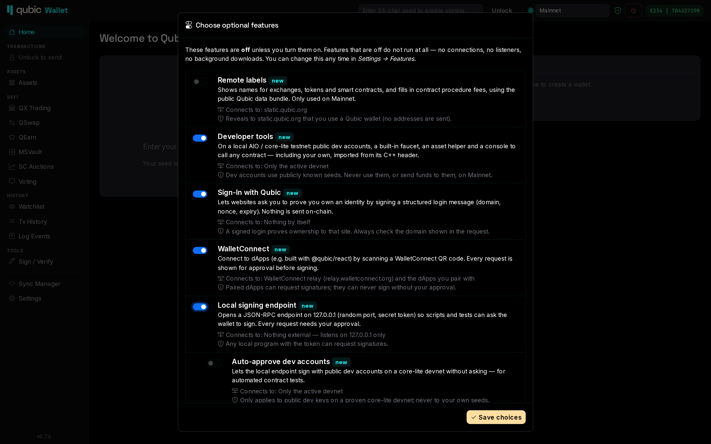

# Optional features

Anything beyond the core wallet is **opt-in**. On the first start of 0.7.0, and after an update that
adds new options, the wallet lists the optional features with what each one does, which servers it
talks to, and the risk to consider. Everything is off until you turn it on.

You can change your choice at any time under *Settings → Features* (Android: *More → Features*).
A feature that is off does not run at all: no background connections, no listeners, no menu entries.

| Feature | What it does | Talks to |
|---|---|---|
| **Remote labels** | Names for exchanges, tokens and smart contracts, and contract procedure fees, from the public Qubic data bundle. Mainnet only. | `static.qubic.org` |
| **Developer tools** | On a local AIO / core-lite testnet: public dev accounts, a faucet, an asset helper, and the Contract Console. See [Developer tools](developer-tools.md). | Only the active devnet |
| **Sign-In with Qubic** | Recognise structured login messages from websites and check them field by field. See [Signing](signing.md#sign-in-with-qubic). | Nothing by itself |
| **WalletConnect** | Pair with dApps by WalletConnect link or QR code. See [WalletConnect](walletconnect.md). | The WalletConnect relay and the dApps you pair with |
| **Local signing endpoint** (desktop) | JSON-RPC on `127.0.0.1` so scripts and tests can ask the wallet to sign. See [Local signing endpoint](local-endpoint.md). | Nothing external |
| **Auto-approve dev accounts** (desktop, needs the endpoint) | Lets the local endpoint sign with public dev accounts on a proven core-lite devnet without asking. | Only the active devnet |

Features never bypass the [signing review](signing.md#the-signing-review). The only exception is
*Auto-approve dev accounts*, and it applies only to public dev keys on a network the wallet has
identified as a core-lite devnet.
