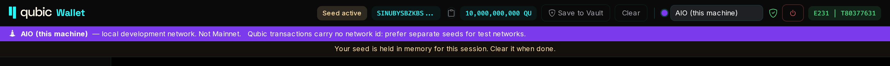
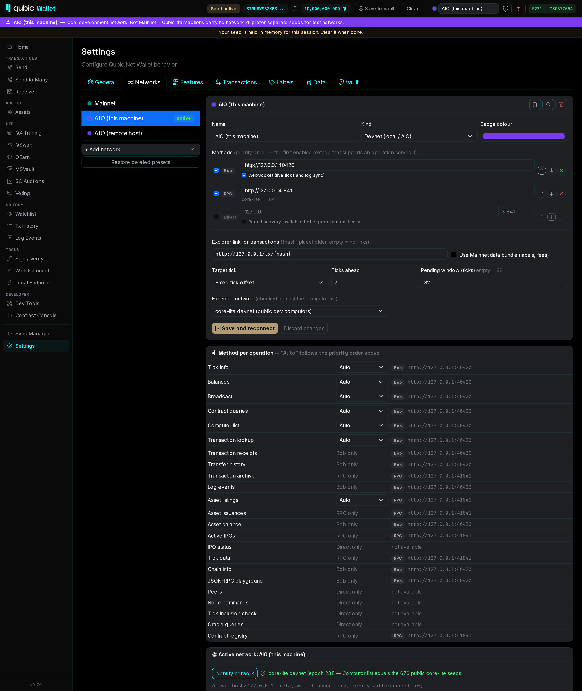

# Networks

Since 0.7.0 the wallet works with **networks** instead of a single backend setting. A network is a
named profile: Mainnet, a local AIO Dev Kit, a shared testnet, or anything you add yourself.
Switch networks with the selector in the header (Android: *More → Networks*).

## Built-in networks

| Network | Methods (priority order) | Notes |
|---|---|---|
| **Mainnet** | RPC `https://rpc.qubic.org` → Bob → Direct | Uses the static.qubic.org data bundle (if *Remote labels* is on) and explorer.qubic.org links |
| **AIO (this machine)** | Bob `http://127.0.0.1:40420` → RPC `http://127.0.0.1:41841` (core-lite HTTP) | Direct `127.0.0.1:31841` is present but off. See the [AIO tutorial](aio-tutorial.md) |
| **AIO (remote host)** | Same as above, for a kit on another host | Edit the host names |

When you first start 0.7.0, your old settings move into the Mainnet network: your RPC/Bob/node
endpoints, your preferred backend (moved to the front of the list) and your tick offset. Mainnet keeps
your existing history database.

Use *Settings → Networks → Add network…* to create a network from a preset or from scratch.
Use *Restore deleted presets* to get a deleted built-in network back.

## What a network contains

- **Name, kind and badge colour.** The kind (Mainnet, Testnet, Devnet, Custom) controls warnings and
  defaults. Every network that is not Mainnet shows a coloured banner under the header.
- **Methods**: one or more of
  - **Bob**: a QubicBob JSON-RPC endpoint, optionally with the WebSocket for live ticks and log sync.
  - **RPC**: an rpc.qubic.org-compatible HTTP API. core-lite's built-in HTTP server is one.
  - **Direct**: a TCP connection to a Qubic node, optionally with peer discovery.
- **Explorer link** for transactions (`{hash}` placeholder; empty means no links).
- **Use Mainnet data bundle**: names for exchanges, tokens and contracts, and contract fees. Only
  meaningful on Mainnet.
- **Target tick** settings (see below).
- **Expected network**: what the network check should find (see below).

Each network has its own history database, asset list, imported contracts and tick settings.
Your vault is shared: any vault works on any network.

## Where requests go: no fallback

Every operation the wallet performs (tick info, balances, broadcast, asset listings and so on) is
served **only** by a method of the active network:

1. If you picked a method for that operation, that method serves it.
2. Otherwise (**Auto**), the first enabled method in the list that supports it serves it.
3. If no method of the network can serve it, the page says *"not available on this network"*.

The wallet does not quietly fall back to `rpc.qubic.org` or any other public service.
The *Method per operation* table in *Settings → Networks* shows each operation's choice and the
endpoint that serves it. Operations that only one method can serve show "Bob only", "RPC only" or
"Direct only".

A pinned choice is strict. If you pin *Balances* to Direct and then disable Direct, balances become
unavailable. The wallet does not switch to another method on its own.

### Connection guard

A second safety net checks every outbound connection. Allowed hosts are the hosts of the active
network's enabled methods, plus the hosts of features you turned on (e.g. `static.qubic.org` for remote
labels, the WalletConnect relay). Any other connection is blocked and listed under
*Settings → Networks → Active network*, with the host and the reason it was attempted.

## Network check (fingerprint)

Bob's `qubic_chainId` reports `qubic:mainnet` even on an AIO kit, so the wallet does not trust it.
It reads the network's **computor list** instead:

- **core-lite devnet**: the 676 computors are exactly the public core-lite dev seeds.
- **Mainnet**: the computor list carries a valid signature from the Mainnet arbitrator.
- **Unknown**: neither.

The result appears as a green shield next to the network name. If the result contradicts the network's
*Expected network* setting (for example, the AIO preset is pointed at a Mainnet Bob), a red sign
appears, and the signing review shows a red warning. The check runs on connect and retries
automatically. *Identify network* runs it on demand.

## Chain resets

An AIO chain restarted with `./scripts/down.sh --wipe` starts again at the same tick numbers.
The wallet records the last epoch and tick it saw for each network. When the epoch goes back, or the
tick goes back on a test network, it treats this as a new chain and clears that network's cached history.
The banner then shows what happened.

## Target tick

A Qubic transaction names the tick in which it executes. Each network chooses its target tick in one
of two ways:

- **Fixed tick offset**: current tick + N (default 7, as before).
- **Execute in ~N seconds**: the wallet measures the tick rate and picks the tick that lands about
  N seconds from now. This works on any network, including Mainnet, and adapts to fast or slow chains.

The send forms show the chosen tick and its ETA before you sign. The **pending window** is how far ahead
the network accepts transactions: 32 ticks on test networks. It is derived from the network kind, and you
can override it. A target outside the window shows a warning in the signing review.

## Switching networks

Switching stops the tick monitor and history sync, closes the current network's database and opens the
next one. The active seed stays loaded. The signing review always names the network you are signing for.

## See also

- [Signing](signing.md): replay warnings when one seed signs on Mainnet and on a test network
- [AIO tutorial](aio-tutorial.md)
