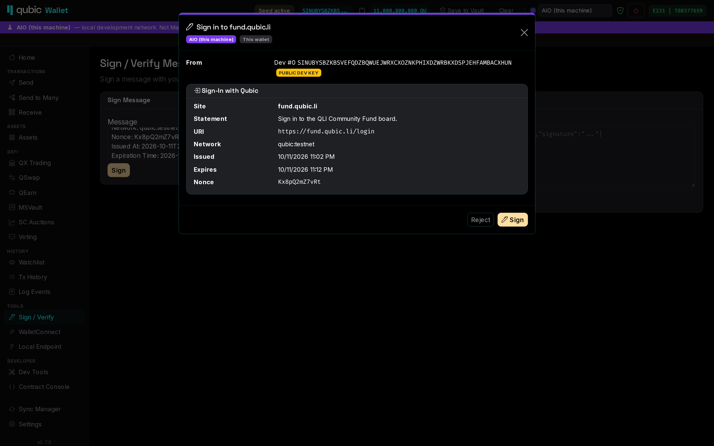
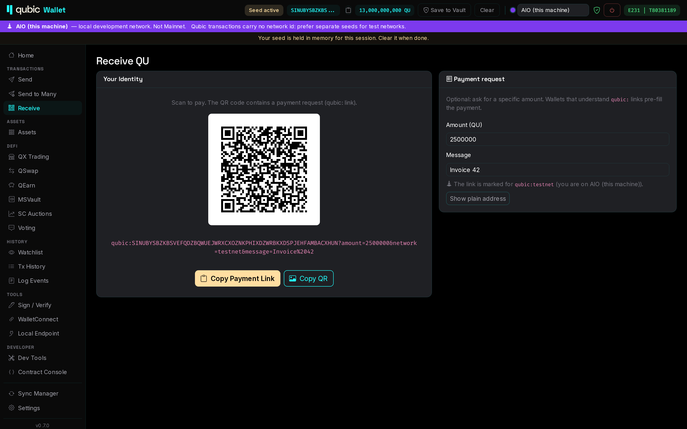
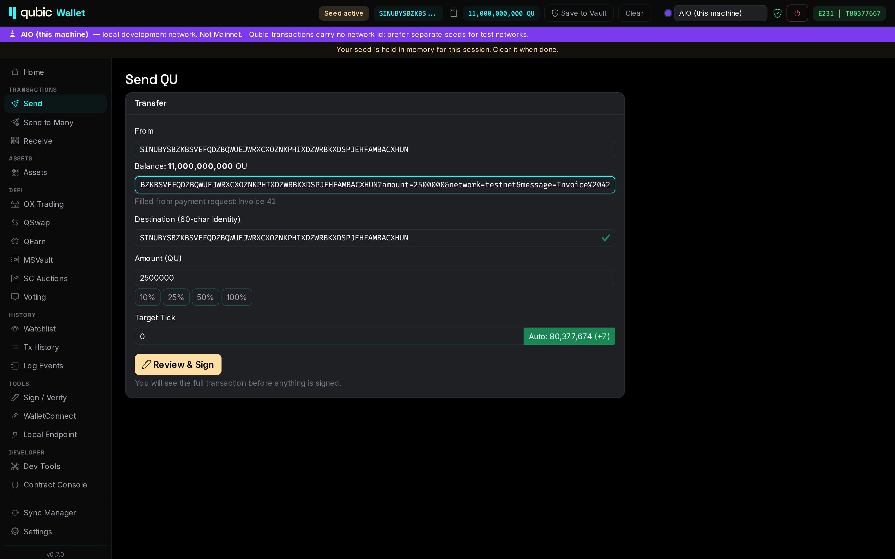

# Signing

## The signing review

From 0.7.0 on, **every signature goes through one review sheet**, whatever asks for it: Send, QX,
Qearn and the other pages, Dev Tools, the Contract Console, WalletConnect or the local signing endpoint.
Nothing is signed until you click **Sign**.


The review shows:

- **Origin**: the wallet itself, a WalletConnect dApp (with its name and URL), or a local client.
- **Network**: the network you are signing for, and the result of the network check.
- **From / To**, with labels from your vault and address book.
- **Amount** and, for contract calls, the **decoded call**: contract, procedure name and every input
  field. This works for all built-in contracts and for contracts you imported in the Contract Console.
  If the input size does not match the expected layout, the review says so.
- **Target tick** with its ETA.
- **Warnings**, ordered by severity (see below).

Send no longer has its own confirm step; the review replaces it.

## Warnings

| Warning | When |
|---|---|
| **Network mismatch** (red) | The network check contradicts the network's settings. |
| **Public dev key on Mainnet** (red) | You sign with a public core-lite dev seed on Mainnet. These keys are public: anyone can spend from them. |
| **Destination is a public dev key** (red) | You send funds to a public dev identity on Mainnet. |
| **Seed used on another network** (red for the first transaction, then amber) | This vault seed has signed on a test network and now signs on Mainnet, or the other way round. |
| **Target tick too far ahead** / **already passed** (amber) | The target tick is outside what the network accepts, or the network has already passed it. |
| **Input size mismatch** (amber) / **Call not decoded** (info) | A contract call's input does not fit the known layout, or the procedure is not in the wallet's metadata. |
| **Sign-in problem** / **Wrong identity** (red) | A Sign-In with Qubic message is expired, not yet valid, for another domain or network, or names another identity. |

### Why the replay warning matters

A Qubic transaction contains no network id, and test networks such as the AIO kit use the same tick
numbers as Mainnet. A transaction signed on a test network can therefore also be valid on Mainnet,
and the reverse is also true. The wallet records which class of network (Mainnet / test) each **vault**
seed has signed on, and warns before a seed crosses over. Keep separate seeds for test networks.

## Sign / Verify messages

*Tools → Sign / Verify* signs any text with your seed and verifies signed messages. This is the same
raw message signing as in earlier versions, with no prefix. It now also goes through the review.

### Sign-In with Qubic

A website can ask you to prove that you control an identity by having you sign a structured login
message. This works like "Sign-In with Ethereum" (EIP-4361):

```text
example.com wants you to sign in with your Qubic account:
BAAAAAAAAAAAAAAAAAAAAAAAAAAAAAAAAAAAAAAAAAAAAAAAAAAAAAAAAAAA

Sign in to Example.

URI: https://example.com/login
Version: 1
Network: qubic:mainnet
Nonce: 8aZ3kQ9xw2
Issued At: 2026-10-11T12:00:00Z
Expiration Time: 2026-10-11T12:10:00Z
```

When the wallet recognises such a message (pasted into Sign / Verify, or requested through WalletConnect
or the local endpoint), it shows each field separately and checks it. The checks are: the identity is
yours, the network matches, the message has not expired and is already valid, and the nonce is well formed.
**Always check the domain:** it names the site you are signing in to.



Nothing is sent on-chain. The signature is a normal raw-message signature over the text, so any server
that verifies Qubic message signatures can check it. Websites can build and verify these messages with
`Qubic.Core.Auth.SignInMessage`. Requires the **Sign-In with Qubic** feature.

## Payment requests

*Receive* can create a **payment request**: a `qubic:` link and QR code with an amount and an optional
message.

```text
qubic:BAAAA…AAAA?amount=5000&message=Invoice%2042
qubic:BAAAA…AAAA?amount=100&network=testnet
```



On a network that is not Mainnet, the link is marked `network=testnet`.

On *Send*, paste a payment link into the field at the top. The wallet fills in the destination, amount
and message. On desktop you can also paste a screenshot of the QR code (Ctrl+V), drop the image on the
field, or use the QR button next to it. If the link is for a different network than the active one, it shows a warning.



The format also supports asset transfers (`asset=NAME.ISSUER`), a requested tick and contract calls
(`inputType`, `input`). See `Qubic.Core.Payments.QubicPaymentRequest`.

## See also

- [WalletConnect](walletconnect.md) and [Local signing endpoint](local-endpoint.md): signing requests
  from dApps and scripts
- [Features](features.md): which of these are opt-in
