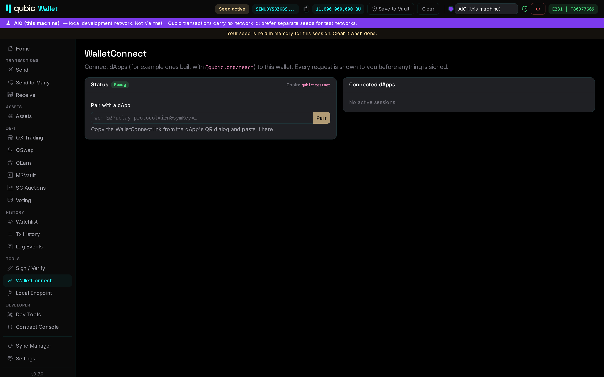

# WalletConnect

With the **WalletConnect** feature on, dApps can connect to the wallet over WalletConnect v2, for
example dApps built with `@qubic/react`. The wallet implements the method set of the official Qubic
wallet, so a dApp that works with the Qubic mobile wallet also works here.

## Pairing

1. In the dApp, choose WalletConnect. It shows a QR code and a `wc:` link.
2. Desktop: copy the link and paste it into *Tools → WalletConnect → Pair with a dApp*.
   Android: tap the scan button and scan the QR code.
3. The wallet shows the dApp's name, URL and the requested network. If WalletConnect Verify flags the
   site, the wallet shows that too. Choose the accounts to share and click **Connect**.

The session uses the chain of the active network: `qubic:mainnet` on Mainnet, `qubic:testnet` on every
other network. A dApp that asks for the other chain is refused, so a Mainnet dApp cannot use your
devnet session or the other way round. *Connected dApps* lists the open sessions; **Disconnect** ends one.

## Methods

| Method | What the dApp gets |
|---|---|
| `qubic_requestAccounts` | Shared accounts with balance and assets |
| `qubic_sendQubic` | Signs and broadcasts a QU transfer |
| `qubic_signTransaction` | Signs a transaction (optionally a contract call) and returns it without broadcasting |
| `qubic_sendTransaction` | Signs and broadcasts a transaction |
| `qubic_sign` | Signs a message using the official convention: the `"Qubic Signed Message:\n"` prefix, K12 digest; returns `signedData`, `digest` and `signature` |
| `qubic_sendAsset` | Signs and broadcasts an asset transfer |

Every request opens the [signing review](signing.md#the-signing-review), which names the dApp it came
from. A request for an account you did not share is rejected.

## Privacy and connections

WalletConnect talks to the WalletConnect relay (`relay.walletconnect.org`) and the verify service. The
connection guard allows these hosts only while the feature is on. The wallet's WalletConnect project id
is built into the app.
